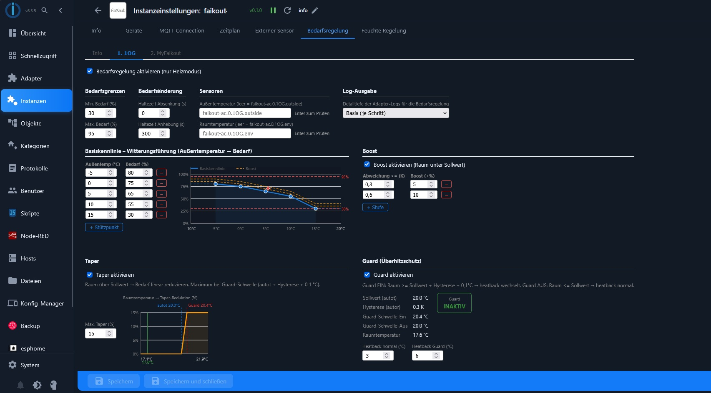

# ioBroker.faikout-ac

ioBroker-Adapter für **Faikout** – den ESP32-basierten Daikin-Controller von [RevK](https://github.com/revk/ESP32-Faikout).

Der Adapter verbindet sich per MQTT mit einem oder mehreren Faikout-Geräten und erkennt bei der Einrichtung automatisch, welche Funktionen das jeweilige Gerät unterstützt. Alle zugehörigen Datenpunkte werden vollständig angelegt und die MQTT-Kommunikation dauerhaft aktuell gehalten – eine manuelle Konfiguration von Topics oder Datenpunkten ist nicht nötig. Sensoren, Steuerbefehle und Geräteparameter stehen direkt in ioBroker zur Verfügung und lassen sich in Skripten, Visualisierungen und Automationen frei nutzen.

Darüber hinaus ergänzt der Adapter zwei Regelfunktionen, die weder Faikout noch Daikin selbst bieten:

> **⚠️ Frühe Betaphase.** Erfolgreich getestet mit mehreren **Single-Split**-Daikin-Geräten. Multi-Split-Unterstützung ab v0.1.3 implementiert, Praxistests laufen. Feedback und Issues sind willkommen.

## Automatische Bedarfsregelung

Im Heizmodus führt der Adapter den `demand`-Wert (Leistungsbegrenzung des Außengeräts) automatisch nach. Grundlage ist eine witterungsgeführte Basiskennlinie (Außentemperatur → Bedarf in %), die sich optional ergänzen lässt:

- **Boost:** erhöht den Bedarf stufenweise, wenn der Raum unter dem Sollwert liegt
- **Taper:** senkt den Bedarf linear, wenn der Raum über dem Sollwert liegt
- **Guard:** Überhitzungsschutz, schaltet bei Überschreiten der Schwelle auf einen größeren heatback-Wert um

Ergebnis: gleichmäßiger Verdichterbetrieb statt Takten und Volllast-Spitzen.

## Feuchteregelung (Taupunktregelung)

Der Adapter berechnet aus Raumtemperatur und Luftfeuchte (BLE-Sensor des Faikout oder ein beliebiger ioBroker-Datenpunkt) den Taupunkt. Ist der Abstand zwischen Raumtemperatur und Taupunkt zu gering oder die relative Feuchte zu hoch, schaltet er das Gerät automatisch in den Entfeuchtungsmodus (**Dry**). Sobald wieder genug Abstand besteht, folgt ein Lüfter-Nachlauf zum Abtrocknen des Wärmetauschers.

- Einstellbare Start- und Stoppschwellen (Taupunktabstand in K, maximale Feuchte in %)
- Zeitfenster, maximale Laufzeit mit Zwangspause und Nachlaufzeit
- Erkennt manuelle Eingriffe am Gerät und überwacht die Aktualität der Sensordaten

## Multi-Split-Unterstützung

Mehrere Innengeräte an einem Außengerät lassen sich zu einer Gruppe zusammenfassen. Die Bedarfsregelung rechnet für jedes Innengerät unabhängig (eigene Raumtemperatur, eigene Kennlinie), setzt aber als Untergrenze das höchste `Mindest-Demand` aller Gruppenmitglieder. So wird verhindert, dass das Außengerät durch ein Gerät mit sehr niedrigem Bedarf zu stark gedrosselt wird, während ein anderes noch Heizleistung braucht. Der Außentemperatursensor wird innerhalb der Gruppe geteilt: wird er bei einem Gerät geändert, übernehmen alle anderen Gruppenmitglieder automatisch dieselbe Auswahl.

## Weitere Funktionen

- Automatische Geräteerkennung (es werden nur die auf dem Gerät aktiven Felder angelegt)
- Mehrere Faikout-Geräte pro Adapter-Instanz
- Multi-Split: Geräte einer Außeneinheit als Gruppe konfigurieren (Gruppen A–E im Geräte-Tab)
- Zeitplan: wochentagsabhängige Schaltzeiten je Gerät mit mehreren Aktionen (z. B. Power, Lüfter, Powerful, Sollwert, manueller Demand-Wert)
- Externen Temperatursensor verknüpfen: ein beliebiger ioBroker-Datenpunkt wird zyklisch als Raumtemperatur (`env`) an den Faikout übertragen und dient dort als Regelgröße

## Voraussetzungen

- ioBroker mit js-controller ≥ 6.0.0 und Admin ≥ 7.0.0, Node.js ≥ 22
- MQTT-Broker (z. B. Mosquitto), für ioBroker erreichbar
- Faikout-Gerät(e) im lokalen Netz, die an diesen Broker senden

## Installation

Der Adapter ist noch nicht im ioBroker-Repository. Installation direkt von GitHub:

1. ioBroker Admin → **Adapter** → Expertenmodus aktivieren → **Aus eigener URL installieren** (GitHub-Symbol)
2. Reiter **Benutzerdefiniert**, URL eintragen: `https://github.com/RaW79/ioBroker.faikout-ac`
3. **Installieren** klicken – der Ordner `build/` ist enthalten, kein Kompilieren nötig
4. Instanz von **Faikout** hinzufügen (`faikout-ac.0`)

### Aktualisierung

Über GitHub installierte Adapter zeigen in ioBroker **keine Updates an und aktualisieren sich nicht automatisch**. Ob eine neue Version vorliegt, lässt sich hier im Repository prüfen (Versionsbadge oben). Zum Aktualisieren die obigen Installationsschritte 1–3 einfach erneut ausführen – der Adapter wird auf den neuesten Stand gebracht, Instanz und Konfiguration bleiben erhalten.

## Einrichtung

1. Reiter **MQTT Connection**: Broker-Host, Port und Zugangsdaten eintragen
2. Reiter **Geräte**: eine Zeile pro Faikout anlegen (Name + IP-Adresse); Checkboxen **Bedarfssteuerung** und **Feuchte Regelung** je Gerät aktivieren falls gewünscht; bei Multi-Split-Anlagen alle Innengeräte desselben Außengeräts auf dieselbe Gruppe (A–E) setzen, Single-Split-Geräte bleiben auf "Single-Split"
3. Speichern, dann für jedes Gerät **Erkennen** klicken
4. Die Datenpunkte erscheinen unter `faikout-ac.0.<Name>.*`

## Lizenz

MIT-Lizenz – siehe [LICENSE](LICENSE)
