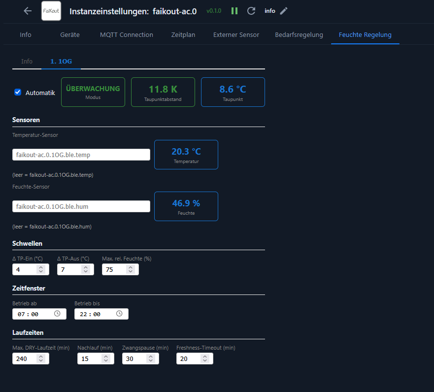

# ioBroker.faikout-ac

[English](#english) | [Deutsch](#deutsch)

---

## English

ioBroker adapter for **Faikout** – the ESP32-based Daikin controller by [RevK](https://github.com/revk/ESP32-Faikout).

The adapter connects to one or more Faikout devices via MQTT and automatically detects which features each device supports. All corresponding states are created and kept up to date via MQTT push. No manual topic or state configuration required. Sensors, control commands and device parameters are available directly in ioBroker for use in scripts, visualisations and automations.

> **⚠️ Beta.** Successfully tested with **single-split** and **multi-split** Daikin devices. Feedback and issues welcome.

### Design Principles

The adapter communicates with Faikout devices through their native interfaces: MQTT for real-time data and partly HTTP for device discovery. **There is no dependency on implementation details of any other platform.** The MQTT broker already running in the network is used directly, no additional infrastructure required. The Faikout device remains accessible to other automation platforms at the same time, in the spirit of an open platform approach rather than a device-specific standalone solution.

### Demand Control

In heating mode the adapter automatically adjusts the `demand` value (outdoor unit power limit) based on outdoor temperature (weather-compensated control curve). Optional extensions:

- **Boost:** increases demand step by step when room temperature falls below setpoint
- **Taper:** reduces demand linearly when room temperature exceeds setpoint
- **Guard:** overheating protection, switches to a higher heatback value when the guard threshold is reached

Result: steady compressor operation instead of cycling and full-load peaks.

### Humidity Control (Dew Point)

The adapter calculates the dew point from room temperature and humidity (Faikout BLE sensor or any ioBroker state). If the margin between room temperature and dew point is too small, or relative humidity is too high, it switches the device to dehumidification mode (**Dry**) automatically. Once the margin is sufficient again, a fan run-on follows to dry the heat exchanger.

- Configurable start and stop thresholds (dew point margin in K, maximum humidity in %)
- Time window, maximum runtime with forced pause and run-on time
- Detects manual overrides on the device and monitors sensor data freshness

### Multi-Split Support

Multiple indoor units on one outdoor unit can be grouped together. Demand control calculates independently per indoor unit (own room temperature, own curve), but uses the highest minimum demand across all group members as a floor. This prevents the outdoor unit from being throttled too much while another unit still needs heating output. The outdoor temperature sensor is shared within the group.

### Further Features

- Automatic device discovery (only active fields are created as states)
- Multiple Faikout devices per adapter instance
- Schedule: weekday-based switching times per device with multiple actions (power, fan, powerful, setpoint, manual demand value)
- External temperature sensor: any ioBroker state is forwarded cyclically as room temperature (`env`) to the Faikout device

### Requirements

- ioBroker with js-controller >= 6.0.0 and Admin >= 7.0.0, Node.js >= 22
- MQTT broker (e.g. Mosquitto) reachable by ioBroker
- Faikout device(s) in the local network publishing to that broker

### Installation

The adapter is available on npm. Install directly from ioBroker Admin:

1. ioBroker Admin -> **Adapters** -> enable expert mode -> **Install from own URL** (GitHub icon)
2. Tab **npm**, enter: `iobroker.faikout-ac`
3. Click **Install**
4. Add a **Faikout** instance (`faikout-ac.0`)

**Updates:** ioBroker Admin will notify you when a new version is available on npm. Update from the **Adapters** tab as usual.

### Setup

1. Tab **MQTT Connection**: enter broker host, port and credentials
2. Tab **Devices**: add one row per Faikout device (name + IP address); enable **Demand Control** and/or **Humidity Control** checkboxes per device as needed; for multi-split systems assign all indoor units of the same outdoor unit to the same group (A–E)
3. Save, then click **Discover** for each device
4. States appear under `faikout-ac.0.<Name>.*`

### License

MIT License – see [LICENSE](LICENSE)

---

## Deutsch

ioBroker-Adapter für **Faikout** – den ESP32-basierten Daikin-Controller von [RevK](https://github.com/revk/ESP32-Faikout).

Der Adapter verbindet sich per MQTT mit einem oder mehreren Faikout-Geräten und erkennt bei der Einrichtung automatisch, welche Funktionen das jeweilige Gerät unterstützt. Alle zugehörigen Datenpunkte werden vollständig angelegt und die MQTT-Kommunikation dauerhaft aktuell gehalten. Eine manuelle Konfiguration von Topics oder Datenpunkten ist nicht nötig. Sensoren, Steuerbefehle und Geräteparameter stehen direkt in ioBroker zur Verfügung und lassen sich in Skripten, Visualisierungen und Automationen frei nutzen.

> **⚠️ Beta.** Erfolgreich getestet mit **Single-Split** und **Multi-Split** Daikin-Geräten. Feedback und Issues sind willkommen.

### Designprinzipien

Der Adapter kommuniziert mit Faikout-Geräten über deren native Schnittstellen: MQTT für Echtzeit-Daten und teils über HTTP für die Geräteerkennung. **Es bestehen keine Abhängigkeiten von Implementierungsdetails anderer Plattformen.** Der im Netzwerk vorhandene MQTT-Broker wird direkt genutzt, ohne zusätzliche Infrastruktur. Das Faikout-Gerät bleibt damit gleichzeitig für andere Automatisierungsplattformen zugänglich, im Sinne einer offenen Plattformlösung und nicht einer gerätespezifischen Einzellösung.

### Automatische Bedarfsregelung

Im Heizmodus führt der Adapter den `demand`-Wert (Leistungsbegrenzung des Außengeräts) automatisch nach. Grundlage ist eine witterungsgeführte Basiskennlinie (Außentemperatur -> Bedarf in %), die sich optional ergänzen lässt:

- **Boost:** erhöht den Bedarf stufenweise, wenn der Raum unter dem Sollwert liegt
- **Taper:** senkt den Bedarf linear, wenn der Raum über dem Sollwert liegt
- **Guard:** Überhitzungsschutz, schaltet bei Überschreiten der Schwelle auf einen größeren heatback-Wert um

Ergebnis: gleichmäßiger Verdichterbetrieb statt Takten und Volllast-Spitzen.

### Feuchteregelung (Taupunktregelung)

Der Adapter berechnet aus Raumtemperatur und Luftfeuchte (BLE-Sensor des Faikout oder ein beliebiger ioBroker-Datenpunkt) den Taupunkt. Ist der Abstand zwischen Raumtemperatur und Taupunkt zu gering oder die relative Feuchte zu hoch, schaltet er das Gerät automatisch in den Entfeuchtungsmodus (**Dry**). Sobald wieder genug Abstand besteht, folgt ein Lüfter-Nachlauf zum Abtrocknen des Wärmetauschers.

- Einstellbare Start- und Stoppschwellen (Taupunktabstand in K, maximale Feuchte in %)
- Zeitfenster, maximale Laufzeit mit Zwangspause und Nachlaufzeit
- Erkennt manuelle Eingriffe am Gerät und überwacht die Aktualität der Sensordaten

### Multi-Split-Unterstützung

Mehrere Innengeräte an einem Außengerät lassen sich zu einer Gruppe zusammenfassen. Die Bedarfsregelung rechnet für jedes Innengerät unabhängig (eigene Raumtemperatur, eigene Kennlinie), setzt aber als Untergrenze das höchste Mindest-Demand aller Gruppenmitglieder. So wird verhindert, dass das Außengerät durch ein Gerät mit sehr niedrigem Bedarf zu stark gedrosselt wird, während ein anderes noch Heizleistung braucht. Der Außentemperatursensor wird innerhalb der Gruppe geteilt.

### Weitere Funktionen

- Automatische Geräteerkennung (es werden nur die auf dem Gerät aktiven Felder angelegt)
- Mehrere Faikout-Geräte pro Adapter-Instanz
- Zeitplan: wochentagsabhängige Schaltzeiten je Gerät mit mehreren Aktionen (Power, Lüfter, Powerful, Sollwert, manueller Demand-Wert)
- Externen Temperatursensor verknüpfen: ein beliebiger ioBroker-Datenpunkt wird zyklisch als Raumtemperatur (`env`) an den Faikout übertragen und dient dort als Regelgröße

### Voraussetzungen

- ioBroker mit js-controller >= 6.0.0 und Admin >= 7.0.0, Node.js >= 22
- MQTT-Broker (z. B. Mosquitto), für ioBroker erreichbar
- Faikout-Gerät(e) im lokalen Netz, die an diesen Broker senden

### Installation

Der Adapter ist auf npm verfügbar. Installation direkt aus dem ioBroker Admin:

1. ioBroker Admin -> **Adapter** -> Expertenmodus aktivieren -> **Aus eigener URL installieren** (GitHub-Symbol)
2. Reiter **npm**, eintragen: `iobroker.faikout-ac`
3. **Installieren** klicken
4. Instanz von **Faikout** hinzufügen (`faikout-ac.0`)

**Aktualisierung:** Der ioBroker Admin meldet neue Versionen automatisch. Update wie bei anderen Adaptern direkt im Reiter **Adapter**.

### Einrichtung

1. Reiter **MQTT Connection**: Broker-Host, Port und Zugangsdaten eintragen
2. Reiter **Geräte**: eine Zeile pro Faikout anlegen (Name + IP-Adresse); Checkboxen **Bedarfssteuerung** und **Feuchte Regelung** je Gerät aktivieren falls gewünscht; bei Multi-Split-Anlagen alle Innengeräte desselben Außengeräts auf dieselbe Gruppe (A–E) setzen
3. Speichern, dann für jedes Gerät **Erkennen** klicken
4. Die Datenpunkte erscheinen unter `faikout-ac.0.<Name>.*`

### Lizenz

MIT-Lizenz – siehe [LICENSE](LICENSE)
